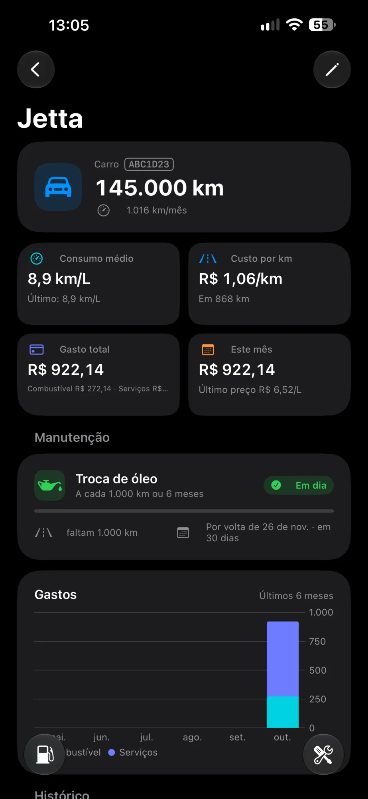
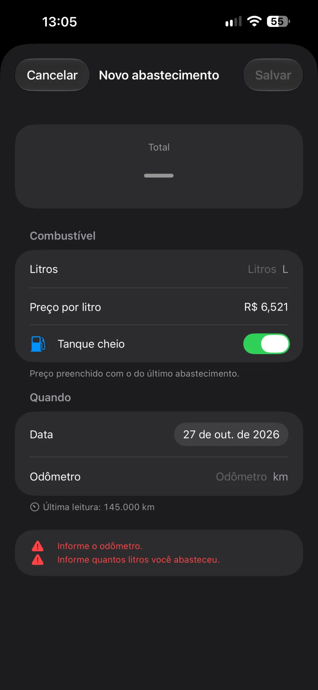
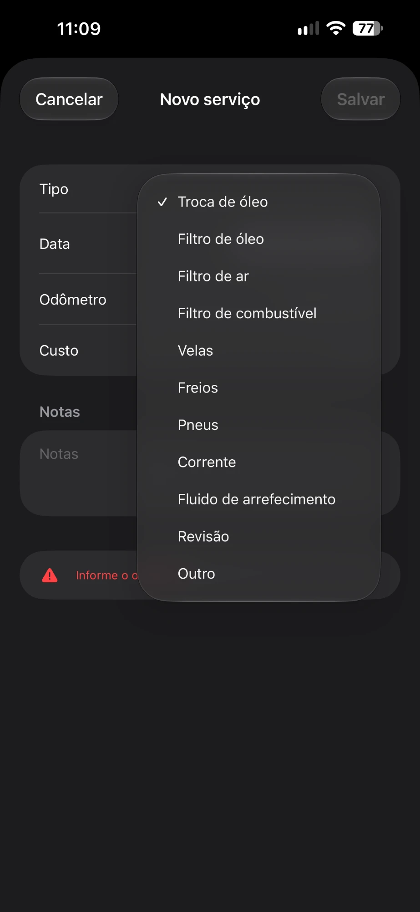
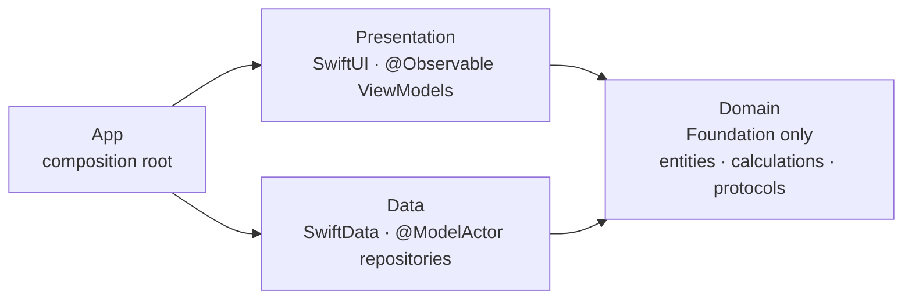

<div align="center">

# Kmais

**Car and motorcycle maintenance tracker for iOS: fuel log, real consumption, cost per km and service reminders.**

[](https://github.com/joaoduartemariucio/kmais-app-ios/actions/workflows/ci.yml)


[](LICENSE)

</div>

<p align="center">
  
  
  
  
</p>

## Features

- **Vehicles** — cars and motorcycles, each with its own history and summary card.
- **Fuel log** — record fill-ups; consumption (km/L) is computed per interval between full tanks.
- **Anomaly detection** — flags entries that break the history (odometer going backwards or unchanged, non-positive liters, duplicates) so the stats can explain why a point was left out.
- **Cost** — total spent, fuel vs. service breakdown and cost per km.
- **Maintenance rules** — oil, filters, spark plugs, brakes, tires, chain, coolant, inspection; due by km and/or by time.
- **Forecast** — projects when the next service is due from the vehicle's own km/month pace.
- **Timeline** — fuel and service entries grouped by month.
- Localized in **English and Portuguese (pt-BR)**, with locale-aware number input and units kept in km and liters.

## Architecture

Three layers in a single app target, with **Repository + MVVM** and the dependency
rules enforced by SwiftLint in CI.



| Layer | May depend on | Never depends on |
|---|---|---|
| `Domain` | Foundation | SwiftUI, SwiftData, `Data`, `Presentation` |
| `Data` | `Domain`, SwiftData | `Presentation` |
| `Presentation` | `Domain`, SwiftUI | `Data` |
| `App` | everything | — |

Highlights:

- **Pure, deterministic domain.** Consumption, cost, odometer and maintenance forecast are
  pure functions in `Domain/Calculations`. The forecast never reads the clock — the latest
  history point acts as "now", so the same history always yields the same prediction.
- **Money in `Decimal`**, never `Double` arithmetic.
- **SwiftData stays behind protocols.** Repositories are `@ModelActor`s that map `@Model`
  types to plain `Sendable` structs. Views never see a `@Model` — which is why the app does
  not use `@Query` (trade-off in [decisions](docs/decisions.md#no-query)).
- **CloudKit-ready schema** (no unique constraints, optional relationships), with orphaned
  records detected and logged by the mappers.
- **Swift 6 concurrency-clean** — main-actor default isolation, `nonisolated` domain, zero
  concurrency warnings.
- **Layer boundaries as lint rules.** Importing SwiftUI or SwiftData in `Domain/`, or
  referencing a `Data` type from `Presentation/`, fails the build:

```yaml
domain_no_swiftdata:
  included: ".*/Domain/.*\\.swift"
  regex: "import\\s+SwiftData"
  severity: error
```

```
kmais-app-ios/
├── App/            # KmaisApp, AppDependencies (only place that creates concrete types), routing
├── Domain/
│   ├── Entities/       # Vehicle, FuelEntry, ServiceEntry, ServiceRule, ...
│   ├── Calculations/   # Consumption, Cost, Odometer, Maintenance, anomalies
│   ├── Repositories/   # protocols
│   └── Services/       # ReminderScheduler, DateProvider (protocols)
├── Data/
│   ├── Models/         # SwiftData @Model types
│   ├── Mappers/        # @Model <-> entity
│   ├── Repositories/   # @ModelActor implementations
│   └── Services/       # UserNotifications, system clock
└── Presentation/   # Vehicles, Fueling, Maintenance, Common (forms, formatting, validation)
```

Design decisions are written down instead of commented in code:

- [Architecture](docs/architecture.md) — layers, data flow, lint rules and how to add a feature
- [Decisions](docs/decisions.md) — what was chosen, why, and what it costs

## Testing

Tests use **Swift Testing**:

- `Calculations/` — consumption, anomalies, cost, odometer and maintenance forecast with fixtures.
- `ViewModels/` — ViewModels tested against in-memory fake repositories, no SwiftData involved.

CI (GitHub Actions) runs `swiftlint lint --strict` and the unit tests on every push and pull request.

## Getting started

Requirements: Xcode with the iOS 26.5 SDK, and [SwiftLint](https://github.com/realm/SwiftLint) (optional locally, required in CI).

```bash
git clone https://github.com/joaoduartemariucio/kmais-app-ios.git
cd kmais-app-ios
brew install swiftlint
open kmais-app-ios.xcodeproj
```

Run the tests from the command line:

```bash
xcodebuild test -project kmais-app-ios.xcodeproj -scheme kmais-app-ios -destination 'platform=iOS Simulator,name=iPhone 16 Pro' -only-testing:kmais-app-iosTests
```

## Roadmap

- Local notifications for upcoming services (the `ReminderScheduler` is in place, not yet triggered by the UI).
- Observe data with SwiftData's `ResultsObserver` (iOS 27) behind the existing repository protocols, replacing reload-after-write.
- iCloud sync via CloudKit (schema is already compatible).
- Promote `Domain` and `Data` to Swift packages once a second surface (widget, App Intents) needs them.

## License

[MIT](LICENSE) © João Vitor Duarte Mariucio
