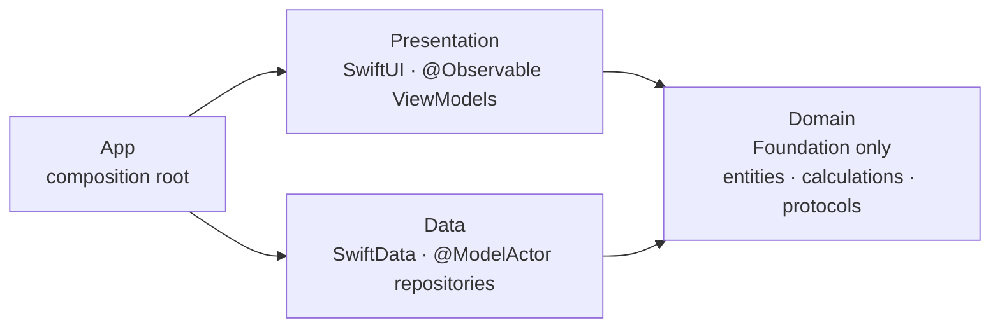

<div align="center">

# Kmais

**Car and motorcycle maintenance tracker for iOS: fuel log, real consumption, cost per km and service reminders.**

[](https://github.com/joaoduartemariucio/kmais-app-ios/actions/workflows/ci.yml)


[](LICENSE)

`Clean Architecture` · `MVVM` · `Repository` · `SOLID` · `Dependency Injection` · `Swift Concurrency` · `Swift Testing` · `CI`

</div>

<p align="center">
  
  
  
  
</p>

## Features

- **Vehicles** — cars and motorcycles, each with its own history and summary card.
- **Fuel log** — record fill-ups; consumption (km/L) is computed per interval between full tanks.
- **Anomaly detection** — flags entries that break the history (odometer going backwards or unchanged, non-positive liters, duplicates) so the stats can explain why a point was left out.
- **Cost** — total spent, fuel vs. service breakdown and cost per km.
- **Maintenance rules** — oil, filters, spark plugs, brakes, tires, chain, coolant, inspection; due by km and/or by time.
- **Forecast** — projects when the next service is due from the vehicle's own km/month pace.
- **Timeline** — fuel and service entries grouped by month.
- Localized in **English and Portuguese (pt-BR)**, with locale-aware number input and units kept in km and liters.

## Architecture

A pragmatic take on **Clean Architecture**: **MVVM** in the presentation layer, the
**Repository** pattern for persistence and **SOLID** — dependency inversion above all — holding
it together. Three layers live in a single app target, and their boundaries are enforced by
SwiftLint in CI.



| Layer | May depend on | Never depends on |
|---|---|---|
| `Domain` | Foundation | SwiftUI, SwiftData, `Data`, `Presentation` |
| `Data` | `Domain`, SwiftData | `Presentation` |
| `Presentation` | `Domain`, SwiftUI | `Data` |
| `App` | everything | — |

### Patterns and where they live

| Pattern | Role | In the code |
|---|---|---|
| **Clean Architecture** | Business rules at the center, frameworks at the edges | `Domain/` imports Foundation only; SwiftData and SwiftUI stay in `Data/` and `Presentation/` |
| **MVVM** | Screen state and logic out of the views | One `@MainActor @Observable` ViewModel per screen (`VehicleDetailViewModel`, `FuelEntryFormViewModel`, …) |
| **Repository** | Persistence behind an interface | Protocols in `Domain/Repositories`, `@ModelActor` SwiftData implementations in `Data/Repositories` |
| **Mapper** | Storage models never leak | `Data/Mappers` turns `@Model` types into plain `Sendable` entities |
| **Dependency Injection** | One composition root | `App/AppDependencies` is the only place that creates concrete types, injected via `@Environment` |

### SOLID in practice

- **S — Single responsibility:** one ViewModel per screen; calculations split by concern
  (`Consumption`, `Cost`, `Odometer`, `Maintenance`); mapping separated from persistence.
- **O — Open/closed:** new behavior is additive — e.g. reactive reads via iOS 27's
  `ResultsObserver` will be a new repository method, with no existing signature changing.
- **L — Liskov substitution:** in-memory fake repositories replace the SwiftData ones in tests,
  and the ViewModels can't tell the difference.
- **I — Interface segregation:** three small repository protocols (`VehicleRepository`,
  `FuelEntryRepository`, `ServiceRepository`) instead of one data manager.
- **D — Dependency inversion:** ViewModels and repositories both depend on abstractions owned
  by `Domain`; nothing in `Domain` knows SwiftData or SwiftUI exist.

### Pragmatic trade-offs

Clean Architecture sized for a one-developer app, on purpose:

- **No use-case layer** — most would be one-line pass-throughs; business rules live in
  `Domain/Calculations` and are tested there.
- **Layers as folders, not modules** — boundaries are guarded by lint instead of the compiler;
  `Domain` and `Data` become Swift packages once a second target (widget, App Intents) needs them.

Each trade-off, with what it costs and when to revisit it, is in [decisions](docs/decisions.md).

### Highlights

- **Pure, deterministic domain.** Consumption, cost, odometer and maintenance forecast are
  pure functions in `Domain/Calculations`. The forecast never reads the clock — the latest
  history point acts as "now", so the same history always yields the same prediction.
- **Money in `Decimal`**, never `Double` arithmetic.
- **SwiftData stays behind protocols.** Repositories are `@ModelActor`s that map `@Model`
  types to plain `Sendable` structs. Views never see a `@Model` — which is why the app does
  not use `@Query` (trade-off in [decisions](docs/decisions.md#no-query)).
- **CloudKit-ready schema** (no unique constraints, optional relationships), with orphaned
  records detected and logged by the mappers.
- **Swift 6 concurrency-clean** — main-actor default isolation, `nonisolated` domain, zero
  concurrency warnings.
- **Layer boundaries as lint rules.** Importing SwiftUI or SwiftData in `Domain/`, or
  referencing a `Data` type from `Presentation/`, fails the build:

```yaml
domain_no_swiftdata:
  included: ".*/Domain/.*\\.swift"
  regex: "import\\s+SwiftData"
  severity: error
```

```
kmais-app-ios/
├── App/            # KmaisApp, AppDependencies (only place that creates concrete types), routing
├── Domain/
│   ├── Entities/       # Vehicle, FuelEntry, ServiceEntry, ServiceRule, ...
│   ├── Calculations/   # Consumption, Cost, Odometer, Maintenance, anomalies
│   ├── Repositories/   # protocols
│   └── Services/       # ReminderScheduler, DateProvider (protocols)
├── Data/
│   ├── Models/         # SwiftData @Model types
│   ├── Mappers/        # @Model <-> entity
│   ├── Repositories/   # @ModelActor implementations
│   └── Services/       # UserNotifications, system clock
└── Presentation/   # Vehicles, Fueling, Maintenance, Common (forms, formatting, validation)
```

Design decisions are written down instead of commented in code:

- [Architecture](docs/architecture.md) — layers, data flow, lint rules and how to add a feature
- [Decisions](docs/decisions.md) — what was chosen, why, and what it costs
- [CI](docs/ci.md) — lint, format, build, test and coverage rules

## Testing

Tests use **Swift Testing**:

- `Calculations/` — consumption, anomalies, cost, odometer and maintenance forecast with fixtures.
- `ViewModels/` — ViewModels tested against in-memory fake repositories, no SwiftData involved.

## CI

Every push and pull request must pass, on GitHub Actions:

| Check | Tool | Rule |
|---|---|---|
| **Lint** | SwiftLint `--strict` | zero violations, including the layer-boundary rules |
| **Format** | SwiftFormat `--lint` | code matches the community-default style in [`.swiftformat`](.swiftformat) |
| **Build** | `xcodebuild build-for-testing` | app and tests compile |
| **Test** | `xcodebuild test-without-building` | every unit test passes |
| **Coverage** | [`scripts/diff_coverage.py`](scripts/diff_coverage.py) + `xccov` | **≥ 80% of the changed executable lines** are covered |

The coverage gate applies to **new code**: lines added or modified by the change, excluding
pure SwiftUI layout and app wiring. Details, every rule and how to run each check locally are in
[docs/ci.md](docs/ci.md).

## Getting started

Requirements: Xcode with the iOS 26.5 SDK, [SwiftLint](https://github.com/realm/SwiftLint) and
[SwiftFormat](https://github.com/nicklockwood/SwiftFormat).

```bash
git clone https://github.com/joaoduartemariucio/kmais-app-ios.git
cd kmais-app-ios
brew install swiftlint swiftformat
open kmais-app-ios.xcodeproj
```

Run the same checks as CI before pushing:

```bash
make ci
```

## Roadmap

- Local notifications for upcoming services (the `ReminderScheduler` is in place, not yet triggered by the UI).
- Observe data with SwiftData's `ResultsObserver` (iOS 27) behind the existing repository protocols, replacing reload-after-write.
- iCloud sync via CloudKit (schema is already compatible).
- Promote `Domain` and `Data` to Swift packages once a second surface (widget, App Intents) needs them.

## License

[MIT](LICENSE) © João Vitor Duarte Mariucio
