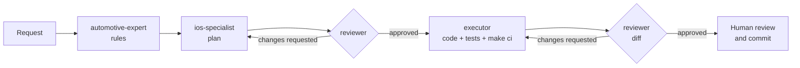

# AI agents

Kmais is built with AI coding agents. Instead of one general-purpose assistant doing
everything, the work is split across four Claude Code subagents defined in
[`.claude/agents/`](../.claude/agents/), and every agent — of any tool — reads the same
project guide, [`AGENTS.md`](../AGENTS.md).

## Why split the work

A single assistant asked to "add oil change reminders" will happily invent a 5,000 km interval,
put the calculation in a SwiftUI view, skip the edge cases and report success. Each of those
failures has a different cause, and each is fixed by a different kind of expertise:

| Failure | Cause | Who prevents it |
|---|---|---|
| The rule is wrong in the real world (intervals, consumption, flex fuel) | Domain knowledge the code can't provide | `automotive-expert` |
| The code fights the architecture (logic in views, SwiftData leaking, concurrency warnings) | Knowledge of this codebase and of iOS | `ios-specialist` |
| Plan and domain disagree; edge cases or tests missing; scope creep | Nobody checking the two against each other | `reviewer` |
| Work "done" that doesn't build or pass CI | Implementation without verification | `executor` + `make ci` |

The split mirrors how a product team works: a domain expert, an engineer who designs, a
reviewer, and someone who ships. The reasons behind it:

- **Domain correctness is the product.** A maintenance app is only useful if its numbers are
  right. Asking a domain specialist *before* designing keeps real-world rules — "whichever
  comes first", full-tank-to-full-tank consumption, odometer typos — from being guessed by
  whoever writes the code.
- **Separation of concerns, applied to agents.** Each agent has one job and a short, specific
  prompt. Narrow agents are more reliable than one agent juggling domain, architecture,
  review and implementation in the same context.
- **Review before code, not only after.** The reviewer checks the plan while changing it is
  still cheap, then checks the diff. Two gates, same reviewer, same rules.
- **Least privilege.** Only `executor` can edit files. The experts and the reviewer are
  read-only, so advice can't silently turn into changes, and every edit comes from an
  approved plan.
- **Verification is not optional.** The executor's job ends when `make ci` passes — the same
  lint, format, build, tests and 80% changed-line coverage that GitHub Actions enforces — not
  when the code "looks right".

## The agents

| Agent | Role | Tools | Edits code |
|---|---|---|---|
| [`automotive-expert`](../.claude/agents/automotive-expert.md) | Real-world rules for cars and motorcycles in Brazil: maintenance intervals, fuel and flex engines, odometer behavior, costs | Read, search, web | No |
| [`ios-specialist`](../.claude/agents/ios-specialist.md) | Turns rules into a plan that fits this architecture: files, types, tests, risks | Read, search, read-only shell | No |
| [`reviewer`](../.claude/agents/reviewer.md) | Checks the rules and the plan against each other and the project rules; later checks the diff | Read, search, read-only shell | No |
| [`executor`](../.claude/agents/executor.md) | Implements the approved plan, writes tests and docs, runs `make ci` until green | Read, write, shell | Yes, never commits |

## Workflow

- Features that touch vehicles, fuel, maintenance or reminders go through the full flow.
- Changes with no domain impact — a typo, a layout tweak, a build fix — go straight to
  `executor`, followed by `reviewer` on the diff.
- **A human always makes the final call and the commit.** No agent commits or pushes.

## Skills

The repo enables the [UI/UX Pro Max](https://github.com/nextlevelbuilder/ui-ux-pro-max-skill)
plugin in [`.claude/settings.json`](../.claude/settings.json), so anyone opening the project in
Claude Code gets it: design guidance (styles, palettes, typography, UX rules, including a SwiftUI
stack) for screen and visual work. Use it when designing or reviewing UI — not for domain or
architecture decisions.

## Shared rules

[`AGENTS.md`](../AGENTS.md) is the single source of truth for commands, architecture rules,
conventions and the definition of done. It is a plain Markdown file that any agent tool can
read; [`CLAUDE.md`](../CLAUDE.md) imports it and adds the Claude Code workflow above. The
subagent prompts reference it instead of repeating it, so a rule changes in one place.
