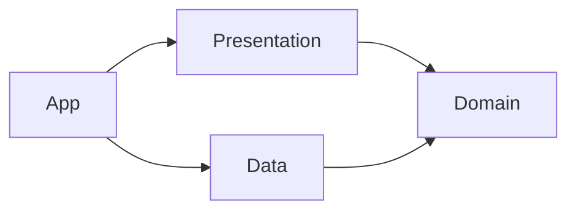

# Architecture

Kmais follows a pragmatic **Clean Architecture** with **MVVM** for screens, the **Repository**
pattern for persistence and **SOLID** principles — mainly dependency inversion. The
[README](../README.md#patterns-and-where-they-live) maps each pattern and principle to the
code; this document covers how the pieces work.

The app is a single iOS target split into four folders. The split is by folder, not by
module, and the boundaries between them are enforced by SwiftLint.

| Folder | What lives there | May use | Must not use |
|---|---|---|---|
| `Domain/` | Entities, calculations, repository and service protocols, errors | Foundation | SwiftUI, SwiftData, `Data`, `Presentation` |
| `Data/` | SwiftData `@Model`s, mappers, repositories, system services | `Domain`, SwiftData | `Presentation` |
| `Presentation/` | Views, `@Observable` ViewModels, form helpers | `Domain`, SwiftUI, UIKit | `Data` |
| `App/` | `KmaisApp`, `RootView`, routing, `AppDependencies` | everything | — |

## Domain

Plain `Sendable` structs and pure functions, all declared `nonisolated` (the project's
default isolation is `MainActor`).

- **Entities** — `Vehicle`, `FuelEntry`, `ServiceEntry`, `ServiceRule`, `OdometerSample`.
- **Calculations** — one namespace per concern, each with its own tests:
  - `Consumption` — km/L per interval between two full tanks, plus `anomalies(in:)`
    (odometer going backwards or unchanged, non-positive liters, duplicates).
  - `Cost` — fuel and service totals, cost per km.
  - `Odometer` — current reading, the full reading history of a vehicle, and
    `neighbors(of:in:)` (the readings right before and after a date).
  - `Maintenance` — km/month pace, next service date and odometer for a rule.
- **Protocols** — `VehicleRepository`, `FuelEntryRepository`, `ServiceRepository`,
  `DateProvider`, `ReminderScheduler`. Everything async and returning entities.

Calculations never read the clock: "now" is either passed in or taken from the latest
reading, so the same input always gives the same output.

## Data

- `Models/` — SwiftData `@Model` types, all suffixed `Model` (the lint rule relies on it).
  The schema follows CloudKit's constraints (no unique attributes, optional relationships)
  even though sync is off (`cloudKitDatabase: .none`).
- `Mappers/` — `@Model` ⇄ entity. A child record without a vehicle is dropped and logged
  through `DataLog.orphanDiscarded`.
- `Repositories/` — one `@ModelActor` per protocol. Each has its own `ModelContext`, so
  every write ends in `commit()` (a `save()` that wraps errors in `RepositoryError`);
  otherwise other repositories would not see the change.
- `Services/` — `SystemDateProvider` and `UserNotificationReminderScheduler`.

## Presentation

One ViewModel per screen: `@MainActor @Observable`, depending only on Domain protocols.

- **Lists and detail** load in `onAppear`/`task` and reload after each write. There is no
  `@Query`, since it would bring `@Model` types into the views.
- **Forms** (`VehicleForm`, `FuelEntryForm`, `ServiceEntryForm`) follow the same shape:
  - fields kept as `String` so "empty" and "zero" are different states;
  - `issues: [ValidationIssue]` computed from the fields. Issues are either **blocking**
    (red, disable Save) or **warnings** (orange, informative only);
  - `FormState` (`editing`, `saving`, `saved`, `failed`) drives the toolbar.
- **Common helpers**:
  - `LabeledNumberField` + `NumberInput.Style` — masked numeric input (see
    [decisions](decisions.md#numeric-fields-are-digit-shifting-masks)).
  - `ValidationFooter` — renders issues with the right color and icon.
  - `FormatStyles` — km, liters, km/L and currency formatting for display.
  - `.dismissesKeyboard()` — tap outside, scroll or "Done" closes the keyboard.

## App

`AppDependencies` is the only place that creates concrete types. It is injected through
the environment (`\.dependencies`) and has three flavors: `live()`, `inMemory()` for
previews and tests, and an automatic in-memory fallback if the on-disk store fails to open.

## Data flow

**Read:** view appears → ViewModel calls repository protocols → repository fetches
`@Model`s and maps them to entities → ViewModel runs Domain calculations
(`VehicleStats`, `VehicleTimeline`) and publishes state.

**Write:** form builds an entity → repository resolves the `@Model` by `id`, applies the
mapper, commits → sheet dismisses → parent ViewModel reloads.

## Enforcement

`.swiftlint.yml` has three custom rules, all `severity: error`:

| Rule | Fails when |
|---|---|
| `domain_no_swiftui` | a file in `Domain/` imports SwiftUI |
| `domain_no_swiftdata` | a file in `Domain/` imports SwiftData |
| `presentation_no_data_types` | a file in `Presentation/` mentions a `Data` type (`VehicleModel`, `ModelContext`, `SwiftData…Repository`, …) |

The Domain rules are exact (they match real imports). The Presentation rule matches
names, so **a new `@Model` must be added to its list**.

Locally the lint build phase only warns if SwiftLint is missing; CI always runs it, along
with the format check, build, tests and the coverage gate. See [CI](ci.md).

## Tests

Swift Testing, in `kmais-app-iosTests/`:

- `Calculations/` — every Domain calculation, with shared fixtures (`day(_:)`, `sample(_:_:)`, …).
- `ViewModels/` — ViewModels against in-memory fakes (`Fakes/InMemoryRepositories.swift`,
  `FixedDateProvider`), plus the number mask.

No test touches SwiftData.

## Adding a feature

1. **Domain:** add or extend the entity and write the calculation as a pure function, with tests.
2. **Domain:** if it needs storage, add the method to the repository protocol.
3. **Data:** implement it in the `@ModelActor` repository; new `@Model`s go in `KmaisSchema`
   **and** in the `presentation_no_data_types` lint rule.
4. **Presentation:** ViewModel talks to the protocol; test it with the in-memory fakes.
5. **App:** only touch `AppDependencies` if a new concrete type is needed.
6. Add user-facing strings to `Localizable.xcstrings` with the pt-BR translation.
