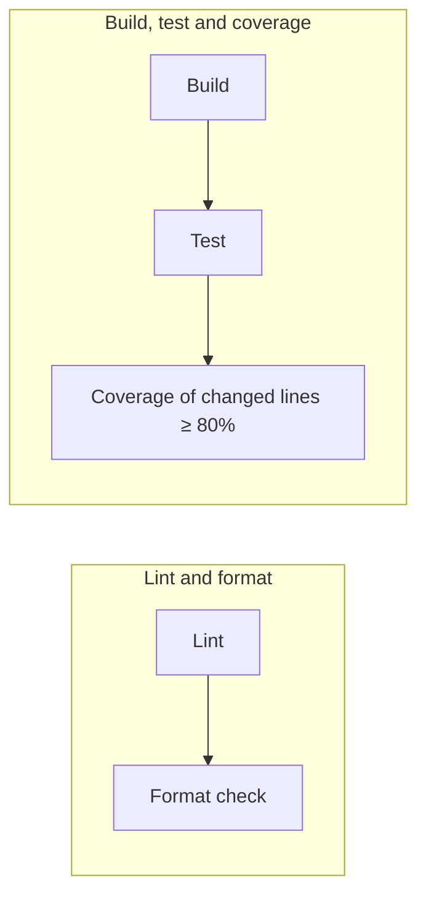

# CI

Every push and pull request runs [`.github/workflows/ci.yml`](../.github/workflows/ci.yml) on
GitHub Actions (`macos-26`, latest stable Xcode). A change is mergeable only when every
check below passes.



The two jobs run in parallel. A newer push to the same branch cancels the run in progress.

## Rules

| Check | Command | Fails when |
|---|---|---|
| **Lint** | `make lint` | any SwiftLint violation, warnings included (`--strict`) |
| **Format** | `make format-check` | any file differs from what SwiftFormat would produce |
| **Build** | `make build` | the app or the test target does not compile |
| **Test** | `make test` | any unit test fails |
| **Coverage** | `make coverage` | less than **80%** of the changed executable lines are covered by tests |

### Lint — SwiftLint

Config: [`.swiftlint.yml`](../.swiftlint.yml). SwiftLint's default rules plus three custom rules
that keep the layers apart:

| Rule | Fails when |
|---|---|
| `domain_no_swiftui` | a file in `Domain/` imports SwiftUI |
| `domain_no_swiftdata` | a file in `Domain/` imports SwiftData |
| `presentation_no_data_types` | a file in `Presentation/` mentions a `Data` type |

SwiftLint also runs as a build phase in Xcode. Locally it only warns when SwiftLint is not
installed; CI always installs it.

### Format — SwiftFormat

Config: [`.swiftformat`](../.swiftformat). [SwiftFormat](https://github.com/nicklockwood/SwiftFormat)'s
default rules — the most widely used baseline in the Swift community — with a few options pinned:

| Option | Value | Why |
|---|---|---|
| Indentation / max width | 4 spaces / 120 | Xcode default; matches SwiftLint's `line_length` |
| Wrapping | arguments, parameters and collections wrap before the first element | one item per line, balanced closing paren |
| Trailing commas | never | SwiftLint's `trailing_comma` rule forbids them |
| `self` | removed where redundant | |
| Imports | sorted, `@testable` last | |
| Number literals | `_` every 3 digits from 4 digits up (`1_000`, `86_400`) | |
| Ranges | `0..<10` | Apple's style |

Off on purpose — added as defaults in recent SwiftFormat releases, not consensus yet:
`wrapPropertyBodies`, `wrapFunctionBodies`, `wrapIfStatementBodies`, `wrapIfExpressionBodies`
(force one-liners onto several lines), `swiftTestingTestCaseNames` (renames tests to raw
identifiers) and `noForceUnwrapInTests` (its `#require` rewrite triggers compiler warnings).

Run `make format` to fix everything at once.

### Build and test

`make build` compiles the app and the unit tests once with coverage instrumentation
(`build-for-testing`); `make test` runs `kmais-app-iosTests` from that build
(`test-without-building`) and writes `.build/TestResults.xcresult`. CI uploads that bundle as
an artifact, so a failure can be opened in Xcode.

The simulator is not hard-coded: [`scripts/simulator-id.sh`](../scripts/simulator-id.sh) picks
an available iPhone on the newest iOS runtime installed. UI tests are not part of CI.

### Coverage of changed lines

The rule is about **new code**, not the whole project: of the executable lines added or
modified by the change, at least **80%** must run during the tests.

[`scripts/diff_coverage.py`](../scripts/diff_coverage.py):

1. diffs the change against its base, ignoring whitespace-only edits:
   - **pull request** → the PR's base commit;
   - **push** → the commit the branch was at before the push (`origin/main` for a new branch);
2. reads per-line execution counts from the `.xcresult` with `xccov`;
3. keeps only executable lines (comments, braces and declarations never count) in files not
   listed in [`.coverageignore`](../.coverageignore);
4. fails if covered / executable < 80%, printing every uncovered line. In CI the same table
   appears in the run's summary.

A change with no executable lines (docs, views only, config) passes automatically.

#### What does not count

[`.coverageignore`](../.coverageignore) lists code with no logic of its own, which unit tests
can't meaningfully exercise:

- `App/` — entry point and composition root;
- SwiftUI views, rows and cards (`*View.swift`, `*Row.swift`, `*Card.swift` and a few
  Common components);
- `KeyboardDismissal.swift` — UIKit glue;
- `Data/PreviewData.swift` — preview fixtures.

**ViewModels, `Domain` and `Data` always count.** Logic in a view belongs in its ViewModel,
where it can be tested. A new SwiftData repository needs tests against an in-memory
`ModelContainer`.

## Running it locally

```bash
brew install swiftlint swiftformat
make ci
```

`make ci` runs the same steps as CI in order. Each one also runs on its own:

| Command | What it does |
|---|---|
| `make lint` | SwiftLint, strict |
| `make format` | formats the code in place |
| `make format-check` | fails if anything would be reformatted |
| `make build` | builds app and tests with coverage |
| `make test` | runs the unit tests |
| `make coverage` | checks changed lines against `origin/main`; `BASE=<ref>` or `MIN_COVERAGE=<n>` to override |
| `make clean` | removes `.build/` |
